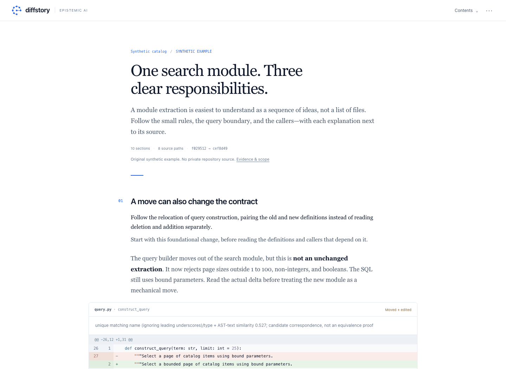

<p></p>

# Diffstory

**Read the change, not just the diff.**

Diffstory turns committed Git changes or a GitHub pull request into an HTML
walkthrough. It places explanations beside the code they describe and keeps the
original diff available, so a reader can follow a change in context.

[Demo](examples/demo.html) · [Contributing](CONTRIBUTING.md) · [Security](SECURITY.md)

[](https://github.com/epistemic-ai/diffstory/tree/python-coverage-comment-action-data)

<p></p>

## Try the demo

Download [examples/demo.html](examples/demo.html) and open it in a browser.
GitHub's file preview does not run HTML. The example uses synthetic code. The
standalone reader works offline and needs no server.

## Analyze local changes

Use Python 3.10 or newer and Git. Clone and install Diffstory, then point it at
the project you want to review:

```bash
git clone https://github.com/epistemic-ai/diffstory.git
cd diffstory
python -m pip install .
diffstory git \
  --repo /path/to/your/project \
  --base main --head HEAD \
  --out walkthrough.html
```

Replace the project path with a local Git checkout. The command compares
committed revisions; it does not include uncommitted changes. Open
`walkthrough.html` in a browser.

## Read a GitHub pull request

```bash
diffstory github 'OWNER/REPO#123' --out pr.html
```

Replace `OWNER/REPO#123` with a pull request. For a private repository, set
`GITHUB_TOKEN` or sign in with `gh auth login`. Diffstory uses the token when
set and can fall back to the signed-in GitHub CLI account. Public pull requests
can be read without credentials.

## Optional model-written explanations

Add `--narrate` to a local or GitHub command to ask for source-linked
explanations:

```bash
diffstory git --repo /path/to/your/project \
  --base main --head HEAD --narrate --out walkthrough.html
```

OpenAI is the default provider and uses `OPENAI_API_KEY`. To use a saved Codex
CLI login, add `--provider codex`. Before it sends source, Diffstory shows the
provider and revision scope, then asks for approval. It sends source only when
you request `--narrate`.

## What the walkthrough shows

Without `--narrate`, Diffstory builds a basic walkthrough locally. It compares
Python code structurally and keeps other languages as text. Original Git
patches stay intact. A separate function comparison can help explain
definitions that moved or changed. The reader keeps original line numbers
beside the prose, and long code blocks expand as needed.

Diffstory does not execute the reviewed code or run the reviewed repository's
tests. The HTML contains the supplied source and assets. It is self-contained
and works offline. Share it as you would the source repository.

Read about [original patch and function comparisons](docs/ARCHITECTURE.md#original-patch-and-function-comparison) and [provider consent and limits](docs/ARCHITECTURE.md#provider-consent-limits-and-state). See [verification](docs/VERIFICATION.md) for checks run on this release.

## Project status

Diffstory 0.3.0 is alpha. The software and original synthetic examples are
[MIT licensed](LICENSE). The Epistemic AI mark has separate terms in
[NOTICE](NOTICE) and the [branding guide](docs/BRANDING.md).
