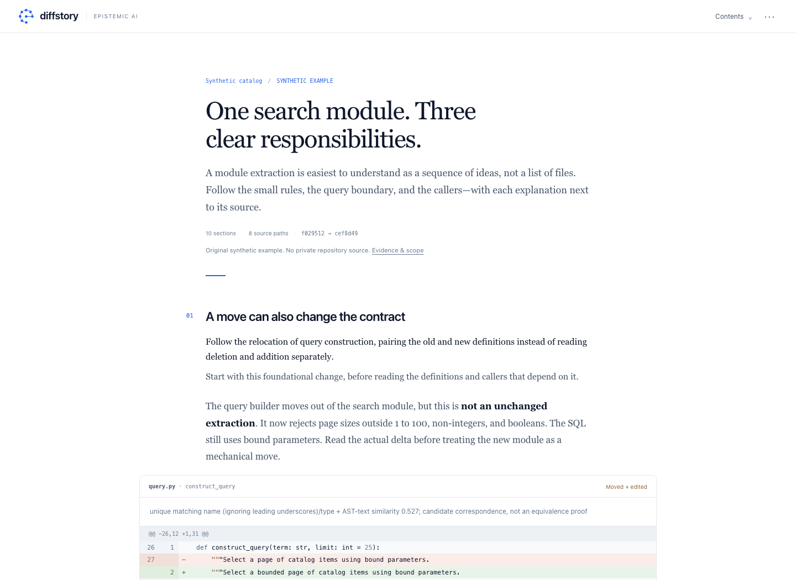

<p></p>

# Diffstory

**Read the change, not just the diff.**

Diffstory turns committed Git changes or a GitHub pull request into an HTML
walkthrough. It places explanations beside the code they describe and keeps the
original diff available, so a reader can follow a change in context.

[Demo](examples/demo.html) · [Contributing](CONTRIBUTING.md) · [Security](SECURITY.md)

[](https://github.com/epistemic-ai/diffstory/tree/python-coverage-comment-action-data)

<p></p>

## Try the demo

Download [examples/demo.html](examples/demo.html) and open it in a browser.
GitHub's file preview does not run HTML. The example uses synthetic code. The
standalone reader works offline and needs no server.

## Analyze local changes

Use Python 3.10 or newer and Git. Clone and install Diffstory, then point it at
the project you want to review:

```bash
git clone https://github.com/epistemic-ai/diffstory.git
cd diffstory
python -m pip install .
diffstory git \
  --repo /path/to/your/project \
  --base main --head HEAD \
  --out walkthrough.html
```

Replace the project path with a local Git checkout. The command compares
committed revisions; it does not include uncommitted changes. Open
`walkthrough.html` in a browser.

## Read a GitHub pull request

```bash
diffstory 'OWNER/REPO#123'
```

Replace `OWNER/REPO#123` with a pull request, or use its GitHub URL. This prepares
model-written explanations with Codex and `gpt-6.1-sol`, asks before sending
source, and writes `walkthrough.html`. Use your saved Codex CLI sign-in, or sign
in with `codex login`. From a source checkout, run
`uv run diffstory 'OWNER/REPO#123'`.

The explicit `diffstory github 'OWNER/REPO#123'` form has the same defaults.
Use `--out pr.html` to choose another output file, or `--no-narrate` to build a
basic report without a model call.

Different PRs and changed inputs keep separate budgets under
`walkthrough.narration-state/`, so they can use the same output filename.
Retrying an identical plan keeps its spent attempts and original deadline.
Use `--fresh-state NEW_DIRECTORY` to intentionally start a new budget.
New runs budget four minutes per writer wave and another four minutes for an
editor when needed. The preview shows the total before confirmation;
`--timeout-seconds` can override it, up to 2,160 seconds. Each provider call
still has a four-minute maximum.

For a private repository, set
`GITHUB_TOKEN` or sign in with `gh auth login`. Diffstory uses the token when
set and can fall back to the signed-in GitHub CLI account. Public pull requests
can be read without credentials.

The `git`, `github`, and `snapshot` commands exclude test files by default.
Add `--include-tests` to include tests in the report and narration:

```bash
diffstory 'OWNER/REPO#123' --include-tests
```

This includes files under `test/`, `tests/`, or `__tests__/`, `conftest.py`,
and common names such as `test_value.py`, `value_test.go`, and `value.spec.js`.
Filtered reports show a scope warning and the number of excluded files.
To restore tests omitted from a saved snapshot, capture the input again with
`--include-tests`.

## Model-written explanations

GitHub PR commands prepare narration by default. Local Git and saved snapshot
commands build basic reports unless you add `--narrate`:

```bash
diffstory git --repo /path/to/your/project \
  --base main --head HEAD --narrate --out walkthrough.html
```

The CLI uses Codex and `gpt-6.1-sol` by default. Use `--model` to select another
supported Codex model. To use the OpenAI API with `gpt-6.1-terra`, add
`--provider openai` and set `OPENAI_API_KEY`. Before it sends source, Diffstory
shows the provider and revision scope, then asks for approval. `--yes` skips
that prompt when you have already approved the transfer.

## What the walkthrough shows

In basic-report mode, Diffstory builds the walkthrough locally. It compares
Python code structurally and keeps other languages as text. Original Git
patches stay intact. A separate function comparison can help explain
definitions that moved or changed. The reader keeps original line numbers
beside the prose, and long code blocks expand as needed.

Diffstory does not execute the reviewed code or run the reviewed repository's
tests. The HTML contains the supplied source and assets. It is self-contained
and works offline. Share it as you would the source repository.

Read about [original patch and function comparisons](docs/ARCHITECTURE.md#original-patch-and-function-comparison) and [provider consent and limits](docs/ARCHITECTURE.md#provider-consent-limits-and-state). See [verification](docs/VERIFICATION.md) for checks run on this release.

## Project status

Diffstory 0.3.0 is alpha. The software and original synthetic examples are
[MIT licensed](LICENSE). The Epistemic AI mark has separate terms in
[NOTICE](NOTICE) and the [branding guide](docs/BRANDING.md).
