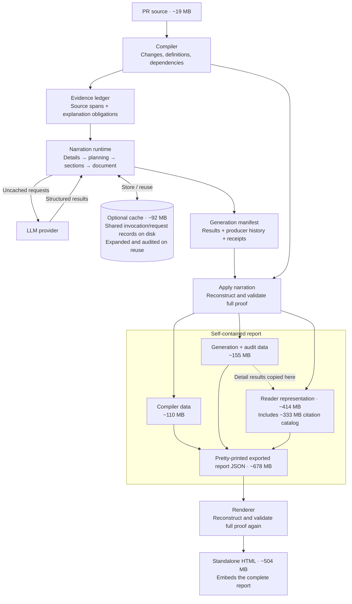
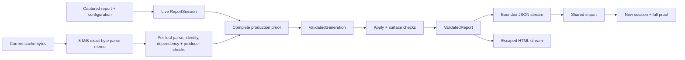

# Internal contract

```text
Original Git/GitHub patches + pinned source
    → retained file patches + separate function comparisons
    → Python AST units
    → conservative cross-file declaration pairs
    → calls / references / imports / test references
    → semantic chapters + prerequisite graph
    → SCC condensation + deterministic reading heuristic
    → baseline narrative + optional revision-bound annotations
    → source-bound prose/code passages
    → continuous HTML document + lazy inline code + machine-readable report
```

## Evidence and presentation are separate

### Original patch and function comparison

The original patch shows what changed in each file. Git ingestion captures the
output of `git diff`; GitHub ingestion retains each file's `patch` from the
[PR files API](https://docs.github.com/en/rest/pulls/pulls#list-pull-requests-files).
We keep that text and its line grouping. We check the rows against
the captured file versions; we do not run another diff algorithm to replace
Git's or GitHub's choices. An incomplete or mismatched patch is rejected.

The **function comparison** is an extra view. It compares the earlier and
later versions of a matched function, even when they are in different files.
It is generated from source and labeled separately. It does not replace the
original patch.

Passages can show excerpts from that original patch. Selecting a smaller
range must not choose a different alignment of its lines. The complete
captured patch remains available under **Original source hunks**.

For example, suppose `normalize_name()` moves from `users.py` to `text.py`.
Both files already exist. The original file patch shows:

```diff
# users.py
-def normalize_name(name):
-    return name.lower()

# text.py
+def normalize_name(name):
+    return name.strip().lower()
```

The optional function comparison shows the small edit more directly:

```diff
 def normalize_name(name):
-    return name.lower()
+    return name.strip().lower()
```

The function moved, and it now removes surrounding spaces before lowercasing.
For a 200-line function, this view avoids reading the whole function twice.
Keep both views: the original patch records the PR; the function comparison
helps explain a move or edit. A proposed match still needs review when the
tool cannot confirm that the two definitions belong together.

If GitHub omits a file patch, record it as unavailable. Do not silently replace
it with a generated diff. Source can still support the separate function
comparison. Snapshots must include a patch record for each file, even when
the patch text is unavailable. Older snapshots without these records are
rejected; capture them again with the current Git or GitHub command.
The retained original text also
keeps file headers and no-newline markers that are not ordinary code rows.

Matching uses four stages: unique same-path/name matches; unique exact-AST cross-file matches; unique function/class matches with only the declaration name and leading docstring excluded; and conservative same-name candidates with a structural similarity threshold. Ambiguous duplicates remain unpaired. Similarity is evidence for correspondence, not evidence for preserved behavior. A same-path implementation edit is not automatically called a behavioral regression.

Module environment differences are deliberately not erased. Renaming a reference inside a body, modifying a literal, or changing a default/decorator prevents exact-match classification.

## Snapshot shape

```json
{
  "schema": "diffstory.snapshot.v1",
  "meta": {
    "repository": "owner/repo",
    "base_sha": "<full effective base commit>",
    "head_sha": "<full head commit>",
    "scope": "changed files",
    "changed_files": 1
  },
  "fragments": [
    {
      "path": "pkg/module.py",
      "side": "head",
      "text": "def f(x):\n    return x\n",
      "start_line": 1,
      "scope": "full"
    }
  ],
  "file_evidence": [{
    "base": {"path": "pkg/module.py", "state": "absent"},
    "head": {"path": "pkg/module.py", "state": "supplied", "coverage": "full"}
  }],
  "patches": [{
    "path": "pkg/module.py",
    "origin": "git",
    "patch": "@@ -0,0 +1,2 @@\n+def f(x):\n+    return x\n"
  }],
  "warnings": []
}
```

Pydantic models in `models.py` validate snapshot fields and source states. Each state has its own fields: an absent file has no coverage or reason, an unavailable file requires a reason, and supplied source requires coverage. `evidence.py` then checks these claims against the actual fragments and parse results. The compiler receives named indexes instead of a positional bundle.

Only the current snapshot contract is supported. `file_evidence` is required. It records the source state of each changed path on both revisions. A side is `absent`, `unavailable` with a reason, or `supplied` with `full` coverage. Git and GitHub ingestion create these records from pinned source reads. A copy or rename keeps its old path on the base side and its new path on the head side. The path link lets the compiler compare the correct files. A missing or skipped read cannot prove that a definition is absent.

Use `scope: "selected excerpts"` for partial snapshots and set each supplied excerpt side to `coverage: "partial"` in its file evidence. If the other revision was not supplied, mark it `unavailable` with a reason. Each excerpt retains its original line offset. When multiple excerpts are supplied from the same file, set a distinct `region` to identify each before/after pair; source ranges must not overlap. Full snapshots include both sides of modified files and the existing side of truly added/deleted files. A confirmed Python definition addition or removal needs full, parsed source for the relevant file pair. A warning about another file, including a Markdown file, does not weaken that evidence. Missing source and parse failures on the relevant file leave the counterpart unresolved. Snapshots without `file_evidence` are rejected.

The report includes `changes`, `groups`, `edges`, `symbol_edges`, `tests`, `raw_files`, `cycles`, `notes`, `warnings`, `stats`, `meta` and `method`. Stable IDs join evidence and narrative. Line URLs bind to a commit, not a moving branch. The renderer rejects malformed identifiers, numeric fields, diff tags and missing group references, escapes source/prose and prevents literal script terminators in embedded JSON.

Snapshots require `patches`, a list of `{path, origin, patch}` records.
The path is the later path from the file evidence; `origin` is `git` or
`github`; `patch` contains the original text or is null when unavailable.
The snapshot's pinned revisions apply to these records too. Patch paths must
be unique, with one record for every file evidence pair. Total retained patch
text has a separate 64,000,000-byte cap. It does not raise the source-byte limit.

## Annotation handoff

```json
{
  "schema": "diffstory.annotations.v1",
  "base_sha": "<same effective base as the report>",
  "head_sha": "<same head as the report>",
  "document": {
    "preamble": "A source-grounded overview of the whole change, before the code tour.",
    "lead": "A short source-grounded opening paragraph.",
    "closing": "The mental model to retain."
  },
  "steps": [{
    "group_id": "<existing group ID>",
    "title": "Explain the abstraction before its callers",
    "intent": "What this change accomplishes, grounded in source.",
    "why_now": "What the previous step established and what this one adds.",
    "takeaway": "The mental model needed for the next step.",
    "invariants": ["A concrete property to verify"],
    "questions": ["A review question, not an invented defect"],
    "evidence_change_ids": ["<change ID belonging to this group>"],
    "transition": "A sentence leading to the next idea.",
    "passages": [{
      "text": "This paragraph explains `the_symbol` immediately before its code.",
      "change_ids": ["<change ID belonging to this group>"],
      "view": "definition",
      "focus": {"start": 120, "end": 130}
    }]
  }]
}
```

The preamble introduces the whole change before the code tour. It is optional in manually authored annotations and required in all generated narration, including saved reports. It can include one compact conceptual sketch; a two-path decision sketch uses a three-line plain-text flow chart. The preamble allows at most 4,000 characters of prose and a separate 4,000 characters for all complete fenced text sketches, including their fences. The whole field is limited to 8,000 characters. Unclosed fences count as prose. Other document prose has a 6,000-character limit. The provider JSON schema comes from the same Pydantic document model used for response validation. The annotation, generated-report, and renderer checks share its field rules and limits.

The compiler rejects a revision mismatch, missing/out-of-group evidence IDs, oversized prose and invalid field types. Annotation fields cannot replace structural matches or claim test execution. The current validator does not prove that a natural-language claim follows from the source. Human review remains necessary.

When an annotation supplies a step for every group, the step array's order is the reading order. Narrated reports may choose a story order, but the validator keeps prerequisite groups before their dependents and groups in a dependency cycle adjacent. The generated step order is applied to the report's `groups` array, so the contents list and rendered document use the same path. Partial manual annotations retain the report's baseline order.

Manually authored annotations can omit passages and group coverage. Generated annotations add a top-level `generation` object with schema `diffstory.generation.v1`. It records `origin: "model_generated"`, `verification: "unverified"`, provider/model, exact revisions, measured usage, expected/completed group and change IDs, chunk coverage, and sanitized errors. It contains no credentials. Generated annotations must have exactly one step for every group, cite every group change, and include nonempty source-bound passages covering every change. Passage focus ranges must fit both the inspected source slice and the report's original source lines. Incomplete generated candidates are rejected.

When generated annotations are applied, the validated `generation` object is copied into the report JSON. Each generated group receives `provenance: "model-generated · unverified"`. Rendering checks the generation revisions, usage shape, chunk completion, group/change coverage, passages, and provenance label again. The reader displays both a document-level warning naming the provider/model and a per-step generated label. Re-rendering a generated report preserves this warning.

## Continuous reader

`document`, `passages` and `transition` are optional fields in manually authored annotations. A focus range must fall inside one supplied head definition (or base when no head exists); ranges refer to original source lines, not snippet-relative offsets. A diff view cannot accept a definition focus. The passage `view` field is validated for focus checks but does not set the reader's initial mode. Repeated references in different passages are allowed for discussing a signature and body separately. Missing references do not remove units: the reader exposes them under Supporting changes. The renderer also validates annotations in a precompiled report.

The UI renders every section and prose passage into one document. Story passages open in diff view; **Read definition** switches a block in place and applies any validated focus range. Test source remains a definition, and raw appendix hunks remain diffs. Narration instructions require backticks around code identifiers, paths, commands and literal values. The renderer styles explicit backtick spans and automatically formats known source names, paths, short variable names and command flags when an annotation omits the markers. An IntersectionObserver defers offscreen code previews; manual load controls provide a fallback. A bounded preview is the default for long definitions/diffs. User expansion adds up to 160 display rows per action. No network fetch is involved: all source is embedded as escaped JSON. There is no side pane, tabbed dashboard or step router. A small Contents popover jumps to stable section anchors, while native page scrolling is preserved.

Supporting units and original raw hunks are created on demand. Source/prose is escaped before display, and the page's CSP disallows network connections, external scripts and object loads.

## Deliberate prototype boundaries

Python AST support is implemented with the standard library, so parse support follows the interpreter running the CLI. A newer-syntax file falls back to textual evidence. Classes are atomic. Static resolution respects common import aliases and avoids simple local/parameter shadows, but does not claim whole-program completeness.

### Legacy narration and shared source limits

The following narration description covers explicit `--architecture legacy` and
the compatible `Narrator` library default. The CLI defaults to v2 when narration
is requested, as described below.

The default narrative uses deterministic templates. The demo adds authored domain-specific annotations. The opt-in `--narrate` path supports the OpenAI Responses API and the user's signed-in Codex CLI. Both providers return structured output and assemble validated source-bound passages with hierarchical summaries. OpenAI requests use its selected model capacity; known Codex overrides use published model capacity, while the CLI default is packed against a conservative 400,000-token context bound. A planning call chooses a story order from group summaries; dependency constraints and cycle groups are enforced before section prose is written. Long source lines are split into bounded slices without dropping text. If a leaf response omits change citations, Diffstory may make one bounded repair request for that chunk. The Codex adapter runs `codex exec` from a temporary directory, in a read-only sandbox, with local shell, browser, app, and plugin tools disabled. Each provider call has a 900-second timeout. Both adapters use the standard library for transport. Shared data validation uses Pydantic. Successful calls contribute provider-reported input, cached input, and output token counts to a run summary; no run-wide token, call-count, or elapsed-time budget is imposed.

Narration tasks run concurrently, with a default limit of four. `--concurrency N` sets a positive limit. Persistent result checkpoints are enabled by default and use `Path(out).with_suffix('.narration-cache')`; `--cache-dir PATH` overrides this location and `--no-cache` disables checkpointing. These options cannot be combined.

The run identity includes the exact base and head revisions, the canonical report input, provider destination, and model. The report input includes its source and pull-request context; only `meta.captured_at` is removed before it is hashed. Each checkpoint key also includes the exact prepared request, response schema, output reservation, task, and validation version. Diffstory validates a saved result again before reuse. A Codex CLI default model has no explicit model identity, so that mode runs without persistence; an explicit `--cache-dir` requires an explicit `--model`.

Progress events report the current stage, active calls, completed and planned tasks, reused checkpoints, provider calls, and elapsed time. Reused checkpoints are counted separately from provider calls and provider-reported cached input tokens. On a stage failure, Diffstory stops new submissions, cancels work that has not started, and waits for active work to finish. Validated results remain checkpointed for a later run.

Git and GitHub ingestion enforce a 64 MB aggregate source limit by default, and snapshot compilation enforces the same limit. The annotation manifest and report retain revisions, measured usage, and chunk coverage without storing credentials. The model-generated warning states that prose remains unverified.

There is no background agent, GitHub write access, production deployment, formal equivalence engine, live coverage ingestion, or automatic merge recommendation. The UI does not execute supplied repository source. JavaScript executes only the local report interface.

## High-value next increments

First add full-repository symbol indexing with explicit resolution confidence and unchanged callers. Then add statement-level extraction matching (for shared helpers cut out of larger functions), followed by test-run artifact ingestion tied to exact revisions. Additional narrative adapters may be added later, but must remain downstream of evidence analysis and must not rewrite classifications or validation status.

## Primary implementation references

- Python AST API: https://docs.python.org/3/library/ast.html
- GitHub pull-request file pagination: https://docs.github.com/en/rest/pulls/pulls#list-pull-requests-files
- GitHub contents API: https://docs.github.com/en/rest/repos/contents

## Default narration architecture v2

`--narrate` uses the v2 pipeline by default. `--architecture v2` also selects it
explicitly. `--architecture legacy` selects the supported legacy pipeline.
The `Narrator` library keeps its legacy default for callers that do not supply
durable v2 state. Library callers select v2 with `architecture="v2"` and a stable
`recovery_dir`. An ordinary command without `--narrate` still produces the
deterministic baseline narrative.

The diagram shows the current v2 data flow. Sizes are approximate decimal MB
from one local synthetic-provider benchmark. Report component sizes use the
pretty-printed JSON representation. These measurements are not fixed limits or
measurements of real LLM prose. Arrows show data flow, not proportional byte
volume.



The report retains overlapping generation and reader records. Applying
narration and rendering the report each reconstruct the offline proof without
provider calls or the optional cache. These checks establish coverage and
reference validity; generated prose remains unverified. Shared cache records
reduce disk duplication, but they are still expanded and audited on reuse.
Sharing exported records and reusing validated immutable data within a run are
future improvements; this diagram describes current behavior.

An evidence unit accounts for supplied source spans and explanation obligations.
An obligation describes a changed region, a structural change, or an explicit
evidence limitation. Unchanged context must remain accounted for but does not
require an invented change explanation. Spans retain side, content, byte range,
and source line bindings. Byte ranges distinguish pieces of the same long line.
Unavailable source cannot prove absence.

A presentation group is a reading step. A provider request can contain units
from several groups, or prose for several sections. Group count therefore does
not determine request count. Packing checks the actual serialized instructions,
schemas, evidence, context, framing, and repair fields. Both input capacity and
output reservations must fit. Response byte and timeout bounds also apply.
Codex retains its maximum output guard because its adapter cannot enforce a
smaller requested output cap. The direct API uses an enforceable output cap.

Detail requests consume source evidence and compiler facts. They produce
separate before/after explanations, supported effects, uncertainty, observations,
and questions. Source-only details do not consume the PR author's motivation or
story order. Later planning, section, and document requests consume validated
support and relevant author context. Their abstractions and synthesis do not
replace or shorten the detailed results. The compiler retains authority over
classification, dependencies, source availability, and test status.

Planning uses bounded cards and a hierarchy over a valid dependency order.
Complete group membership, cross-chapter prerequisites, cycle adjacency,
terminology, and claim references survive each level. Large inputs require more
levels; they are not silently truncated. Sections share the same plan and
receive relevant prerequisite facts and neighboring context. The final section
has no outgoing transition. Inherited statements retain a typed chain of
support to the original source or observation, including the actual producer
request. Assembly retains every detail result, including empty acknowledgements
for supplied context.

### Persisted validation and artifact reuse

New candidates use `diffstory.annotations.v2` and a
`diffstory.generation.v2` manifest. The manifest records the exact run, ledger
parameters, declared request configuration, details, plan, prose, original
producers, and result receipts. Its closed types reject unknown fields.
Production, reuse, annotation application, and rendering validate complete
coverage and exact citations. Wrong sides, ranges, content, unknown handles,
duplicates, and cross-group citations fail validation.

Saved v2 annotations and reports can be applied, reloaded, and rendered offline.
Validation reconstructs the declared request protocol as data; it needs no
provider credentials, executable lookup, subprocess, or provider request. The
reader uses a validated source catalog with current fragment, side, byte range,
line number, revision, and URL bindings. It preserves original detailed prose
and support provenance. These checks establish coverage and reference validity;
the prose still carries the model-generated, unverified label. They do not prove
natural-language correctness or test execution.

Run identity remains bound to exact revisions and report input. Artifact
identity includes relevant evidence, context, provider/model/configuration,
prompt, schema, and validator dependencies. Each item keeps all original
co-batched dependencies and the original invocation and producer. A change to a
peer can invalidate that item's reuse. A changed reading order can invalidate
section context and transitions. Source-only details can remain reusable when
author context changes. Content-stable handles resolve to current source
bindings during assembly; reuse does not preserve stale revision URLs.

V2 uses a separate artifact format with atomic writes and validation on reuse.
The legacy exact-run cache reader remains available. Old records are not
relabeled as v2 proof. Compatibility reuse must meet the current obligations and
retain the original producer, request, dependencies, and validation history.

Saved generation storage has a separate version from the semantic manifest.
New annotations and applied reports retain `generation.version` as
`diffstory.generation.v2` and keep `request_configuration` in the same location.
The marker `storage_version: "diffstory.generation-storage.v1"` declares compact
producer invocations. Each `diffstory.invocation-storage.v1` invocation stores
the six static dependencies once, ordered item lookups, all dynamic dependencies
(including every original peer), and the exact original `BatchSpec`. Original
run identities, successful request metadata, results, receipts, coverage, and
citations remain complete. Each annotation, report, and HTML contains the proof
data it needs; offline validation does not read the optional cache.

Readers still accept expanded v2 generation data without a storage marker.
They expand compact invocations before the existing manifest and production
checks. Unknown versions, mixed shapes, missing dependencies, and unknown fields
fail. Exact candidate comparison normalizes only this declared storage form;
it preserves every application field, scalar type, and list order. Compact
invocations must round trip to their exact stored form. A content digest alone
does not authorize a producer, request, result, or current source reference.

The optional typed cache writes `artifacts-v3/invocations`,
`artifacts-v3/requests`, and `artifacts-v3/items`. Full-content storage digests
address shared compact invocations and successful request metadata. Item leaves
reference those records and retain their result and original identity bindings.
Runtime semantic models, artifact keys, and provider request bytes remain
expanded v2. Valid self-contained `artifacts-v2` records remain readable and
importable after current proof checks; existing cache files are not rewritten.
A v3 leaf needs its local reference closure. It is not a standalone export.

Cache writes create a mode-0600 temporary file, sync it, then publish it with a
create-only hard link and sync the directory. Shared dependencies publish before
the leaf. An existing address must contain the same validated full content.
Missing, malformed, wrong-kind, or digest-mismatched cache records are misses;
coherent substitutions still face current producer and source audits. There is
no trusted cross-call record memo. Interrupted writes can leave unreferenced
records or temporary files; no garbage collection is added. Filesystem hard
links and file/directory sync must be supported. Recovery storage, durable
budgets, and resume rules are unchanged.

The local benchmark reserves space before both recovery writes and each exact
shared-cache or leaf temporary write. Its initial detail estimate measures
compact invocation, successful-request, and leaf metadata bytes, excluding
unknown results and later repairs. Repeated expanded invocation bytes are only
a hypothetical legacy comparison. File totals include all shared files and
leftovers. Marker bindings include the storage module; an old marker fails
comparison and is never silently rewritten. These measurements do not establish
whole-PR savings or change narration defaults.

### Recovery, optional payload storage, and deliberate fresh state

Every CLI v2 run, including default `--narrate` commands, has durable recovery
state. Its default path is
`Path(out).with_suffix('.narration-state')`. `--state-dir PATH` selects a stable
alternative. Keep that path across restarts. Changing the output path changes
the default state path, so use `--state-dir` when renaming outputs for the same
work. Recovery records retain attempt budgets, partial completion, and original
producer history. They can contain source-derived audit data; treat them with
the same care as saved reports.

The optional result payload cache still defaults to
`Path(out).with_suffix('.narration-cache')`. `--cache-dir PATH` changes it;
`--no-cache` disables it. Recovery remains active with `--no-cache`. An unresolved
Codex default model also disables payload caching, but retains recovery budgets.
An explicit Codex `--cache-dir` still requires an explicit `--model`.

Recovery metadata alone cannot reconstruct unavailable result prose. A later
run without the needed payloads stops with `results_unavailable`; it does not
receive new attempts automatically. Restore the matching payload cache when
available. If a new budget is intentional, use `--fresh-state NEW_DIRECTORY`.
This option requires a directory that does not yet exist and cannot be combined
with `--state-dir`. It retains the old directory and does not clear the payload
cache. Valid cached results can still be reused. A later restart uses
`--state-dir NEW_DIRECTORY`, not another fresh-state action. No additional
confirmation prompt is introduced; the existing source-transfer confirmation
still applies.

Each original batch lineage has a durable total-attempt limit. Each node allows
at most one transient retry and one targeted repair. A valid partial response
keeps successful items and repairs only missing or invalid items. A malformed
envelope does not yield guessed partial results. Persistent size failures may
split at declared item boundaries, subject to split depth and the original
shared budget. Restarting and splitting do not reset spent attempts.
Authentication and prohibited-tool failures stop immediately. The scheduler
stops new submissions, cancels queued work, and drains active work before the
CLI reports usage. A failure exits with status 2; an interruption exits with 130.
Storage errors, corrupt state, exhaustion, and missing payloads never trigger
automatic deletion, reset, or selection of a fallback recovery directory.

Diagnostics expose only fixed reason codes and validated stage, task digest,
position, attempt, input/output bounds, response bytes, usage availability,
item counts, and retry/repair/split/reuse counters. They do not print response
bodies, source, secrets, arbitrary exception text, or untrusted validation field
names and locations. This boundary also applies to saved-report rendering and
annotation application. Credential errors give provider setup guidance without
printing keys or raw adapter errors.

### Preview, progress, usage, and JSON limits

The local v2 preview freezes the actual report, options, and provider
configuration used by generation. Mutation after approval fails before a send.
The preview prints logical evidence units, presentation groups, and the actual
packed base detail plan. Its initial-send count describes that plan before
cache reuse, recovery, and repairs. It does not audit stored state and does not
promise that a warm run will send that count. Planning, section, and document
request counts remain unknown until validated outputs exist. There is no exact
full-run call estimate and no calibration model request.

Progress counts completed/planned provider batch lineages, active requests,
actual current attempts, retries, targeted repairs, splits, and artifact lookup
hits. Lineage counts and lookup hits are not logical evidence/result counts.
Progress is throttled between stage boundaries. A successful summary separately
counts validated logical results and unique reused results from final receipts.
Current provider-reported tokens exclude historical producer usage. Original
producers are retained for audit; their prior work is not charged to the new
run. Provider cached-input tokens are a separate provider measurement.

Report and annotation JSON have a default encoded file limit of 256,000,000
bytes. `--max-report-bytes N` selects an explicit positive bound for reading and
writing these files. Saved snapshots keep the 80,000,000-byte JSON input bound,
and compilation and ingestion retain the 64,000,000-byte aggregate source cap.
Raising a report bound does not raise the source cap or weaken field validation.
Reads are bounded even if the file grows after its size check. Invalid JSON
objects and non-finite constants are rejected without printing their contents.

Generation checks encoded report and annotation sizes before writing output.
If a result exceeds the selected limit, the error gives the required byte bound.
Use that explicit bound for generation and subsequent reload if intended. This
provides a supported reload route without silent truncation or an unbounded
read. The default accommodates the known 109,957,391-byte compiled-report size;
the synthetic-provider benchmark in the diagram measures exported narrated
size. Live-provider memory use, pinned cold/resumed performance, and narration
quality require separate measurements. No call target, current-PR benchmark
success, or live-model quality result is claimed here.

### Supported UV commands

The existing source-limit and source-transfer confirmation behavior is retained.
Both repository/PR-number and URL forms are supported. These commands use the
v2 default:

```sh
uv run --locked diffstory github 'owner/repo#123' --narrate --provider codex --model gpt-6.1-sol --out walkthrough.html
uv run --locked diffstory github https://github.com/owner/repo/pull/123 --narrate --provider codex --model gpt-6.1-sol --out walkthrough.html
uv run --locked diffstory git --repo . --base BASE --head HEAD --narrate --provider codex --model gpt-6.1-sol --out walkthrough.html
```

To select the supported legacy pipeline explicitly:

```sh
uv run --locked diffstory github 'owner/repo#123' --narrate --architecture legacy --provider codex --model gpt-6.1-sol --out legacy.html
```

Approve the displayed source transfer interactively, or supply the existing
`--yes` option after approving the destination and scope. `--max-source-bytes N`
can lower the source limit. `--concurrency N` controls active narration jobs.

```sh
uv run --locked diffstory github 'owner/repo#123' --narrate --provider codex --model gpt-6.1-sol --state-dir walkthrough.narration-state --no-cache --out walkthrough.html
uv run --locked diffstory github 'owner/repo#123' --narrate --provider codex --model gpt-6.1-sol --fresh-state retry.narration-state --out walkthrough.html
uv run --locked diffstory render walkthrough.report.json --out reloaded.html
uv run --locked diffstory render compiler.report.json --annotations walkthrough.annotations.json --out annotated.html
uv run --locked diffstory render large.report.json --max-report-bytes 512000000 --out reloaded.html
```

The two default state/cache suffixes are ignored by Git. Custom paths should be
kept outside version control. No command above publishes a report or changes
repository source.

## Implemented shared records and run-scoped validation

This section documents the implemented indexed/shared path and supersedes earlier statements about rebuilding full expanded reports during output and reparsing shared cache records for each lookup. The earlier flow and measurements remain the expanded-format baseline. Expanded output remains the default and rollback path.



A `ReportSession` owns a detached immutable snapshot of the report and request configuration. It issues distinct `ParsedRecords`, `ValidatedGeneration`, and `ValidatedReport` capabilities. Parsing alone grants no proof authority. The session registers the exact capability object and pins its scope, configuration, validation versions, run identity, source bytes, source and revision bindings, and completed proof inputs. A copied or serialized value cannot transfer authority. Closing the context expires its handles and retained proofs.

Fresh generation, apply, and trusted output can reuse completed proof work only through the exact live handle in that session. Each operation rechecks handle identity, captured inputs, current bindings, and limits; HTML still checks and escapes every output. A persisted shared import starts a new session and performs a complete independent proof. Public dictionary apply, validation, and rendering also create fresh proof scopes. An annotation import must include its matching compiler report. The changed-input boundary maps only known capture or binding changes to the public dependency-change error; unrelated mutation or validation errors remain visible.

The `diffstory.report-storage.v1` envelope has 13 closed typed tables: results, plans, evidence references, source targets, resolved citations, URLs, runs, invocations, requests, producers, receipts, readers, and inherited provenance. Pointers are legal only at declared schema positions. A canonical content address checks record integrity; it does not establish proof authority. Reports carry the full source and proof closure, including producer, request, peer-dependency, receipt, and support records. The codec preserves field presence, scalar types, source coordinates, and semantic array and group order. A literal compiler field named `$ref` remains ordinary data. Table references do not rewrite compiler data.

`report_data()` and full expansion are explicit compatibility adapters. The indexed production, apply, export, and browser paths use the shared graph and reader indexes without first building a full expanded generation and presentation tree.

The public narrator path keeps one session open through generation, apply, and writing:

```python
with narrator.capture_session(report) as session:
    generation = narrator.generate_validated(report, session=session)
    applied = session.apply(generation)
    with output_path.open("wb") as output:
        for chunk in session.iter_report_json(
            applied,
            report_storage="shared",
            max_output_bytes=256_000_000,
        ):
            output.write(chunk)
```

For fresh bytes, `ReportSession.import_indexed` requires `max_input_bytes` and returns `(ReportSession, ValidatedGeneration)`. Report bytes contain their own base report, so omit `compiler_report`; passing a non-null value is rejected. Annotation bytes require `compiler_report` set to the matching compiler report. Keep the returned session live through apply and output:

```python
session, generation = ReportSession.import_indexed(
    report_bytes,
    max_input_bytes=256_000_000,
)
with session:
    applied = session.apply(generation)
    with output_path.open("wb") as output:
        for chunk in session.iter_report_json(
            applied,
            report_storage="shared",
            max_output_bytes=256_000_000,
        ):
            output.write(chunk)
```

The caller or CLI remains responsible for source-transfer consent before provider work.

The artifact cache now keeps an 8 MiB per-store parse memo. It reads each leaf and its shared records from disk on every lookup, then reuses parsing and expansion only when the bytes read match a previously checked byte value exactly. Paths, timestamps, sizes, and content addresses do not grant reuse. Leaf identity, current dependency membership, result validity, and applicable producer/request audits still run for every lookup. Eviction causes another parse. This cache memo is separate from session proof reuse and from report-record sharing. Provider schemas, packing, retries, budgets, durability, recovery, invalidation, and legacy behavior keep their existing contracts.

The browser builds one index over the shared graph and creates a temporary projection for the section it renders. It retains complete prose, context, source, provenance, and proof data in the offline page; it does not build a second full presentation tree. JSON and HTML writers emit bounded chunks of at most 16 KiB. The HTML writer escapes script-context data, checks the live handle during output, and enforces its cap over encoded HTML bytes. The CLI accepts `--report-storage shared`; expanded remains the default. An expanded v2 report selected for shared output passes through the explicit codec adapter and a fresh proof import. `--max-report-bytes` and `--max-html-bytes` are separate positive encoded-byte limits, each defaulting to 256,000,000 bytes. Raising either report or HTML limit does not raise the source cap.

The CLI stages each requested file in a temporary file beside its destination and promotes files after writers finish. Promotion uses sequential replacements. A cross-directory I/O failure during promotion can leave a partially promoted set of outputs.

Measurements support a tradeoff, not a general performance claim. Python compact `generation-storage.v1` bytes versus shared report bytes were:

| Count | Compact expanded | Shared | Change |
|---:|---:|---:|---:|
| 2 | 101,285 | 98,156 | −3.1% |
| 4 | 176,479 | 166,792 | −5.5% |
| 8 | 326,851 | 304,048 | −7.0% |

Across six matched same-proof timing pairs, shared medians were about 1.1–1.5% lower in wall time and 1.2–1.6% lower in thread CPU; several ranges overlap. The exact authored fixture went from 5,367,644 compact expanded bytes to 5,852,636 shared bytes (+9.04%). Table and reference overhead exceeded the duplicates left in that already compact baseline.

The browser 2/4/8 mixed-prose fixtures contain different report bytes from the Python 2/4/8 fixtures, which is why their byte savings differ. They showed shared raw JSON reductions of 9.22%, 10.96%, and 12.06%. On the exact fixture, shared output instead increased retained V8 heap after garbage collection from 8,347,964 to 9,163,988 bytes and raised index build time from 3.8 to 6.3 ms (three observations). Retained heap is not peak memory and excludes native DOM memory.

One instrumented Python run measured exact-fixture shared import at 54.362 seconds, with indexed production proof nested at 52.1505 seconds and unique-row structural validation at 0.6461 seconds. The results show that independent proof can remain expensive. Small matched timing gains do not establish a general CPU, RSS, or memory win; whole paired-process RSS includes both formats and cannot compare per-format peaks. Shared output therefore remains opt-in.
